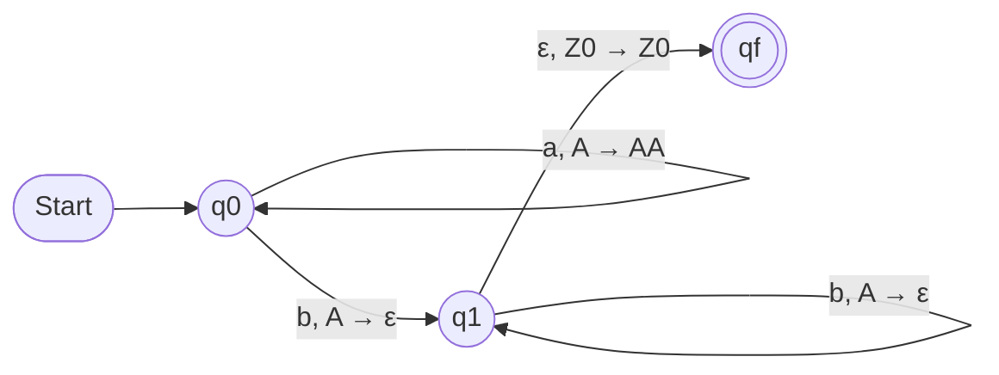

# Experiment 13 – Design PDA Using Simulator to Accept the Input String `aabb`

## Aim
To design and simulate a Pushdown Automaton (PDA) that accepts the input string `aabb`.

## Software
AutoSim – automata simulator supporting deterministic and nondeterministic pushdown automata (DPDA/NPDA).

## PDA Design
The PDA recognizes the language:

`L = { a^n b^n | n >= 1 }`

It pushes one stack symbol `A` for every input `a`. When the first `b` is read, it changes to the popping phase and removes one `A` for every `b`. It accepts when the input is fully consumed and only the bottom marker `Z0` remains.

- States: `Q = {q0, q1, qf}`
- Input alphabet: `Σ = {a, b}`
- Stack alphabet: `Γ = {A, Z0}`
- Initial state: `q0`
- Initial stack symbol: `Z0`
- Final state: `qf`

## Transition Function
Transition notation: `(current state, input symbol, stack top) → (next state, stack replacement)`. The leftmost symbol in the replacement becomes the new stack top.

| Current state | Input | Stack top | Next state | Stack replacement |
|---|---|---|---|---|
| q0 | a | Z0 | q0 | AZ0 |
| q0 | a | A | q0 | AA |
| q0 | b | A | q1 | ε |
| q1 | b | A | q1 | ε |
| q1 | ε | Z0 | qf | Z0 |

There are no transitions on `a` from `q1`, so an `a` cannot occur after the PDA starts reading `b` symbols. An unmatched `a` or `b` leaves the machine without an accepting transition.

## State Diagram

## Simulation Trace for Input `aabb`

Stack is shown with its top at the left.

| Step | State | Input read | Remaining input | Stack |
|---:|---|---|---|---|
| 0 | q0 | — | aabb | Z0 |
| 1 | q0 | a | abb | AZ0 |
| 2 | q0 | a | bb | AAZ0 |
| 3 | q1 | b | b | AZ0 |
| 4 | q1 | b | ε | Z0 |
| 5 | qf | ε | ε | Z0 |

## Result
The PDA consumes the complete input `aabb`, matches both `a` symbols with two `b` symbols using the stack, and reaches final state `qf`. Therefore, **the string `aabb` is ACCEPTED**.

## Additional Test Cases
- `ab` – Accepted
- `aabb` – Accepted
- `aaabbb` – Accepted
- `aab` – Rejected (unmatched `a`)
- `abb` – Rejected (extra `b`)
- `abab` – Rejected (an `a` occurs after the popping phase begins)

## AutoSim Reference
AutoSim is a Java-based command-line automata simulator that supports DPDA and NPDA execution and stack traces. The transition table and trace above specify the PDA to enter and verify in AutoSim. The simulator JAR could not be downloaded in this execution environment, so this repository document records the complete machine design and manually verified execution trace; it does not claim to contain an AutoSim-generated screenshot or native AutoSim project file.
